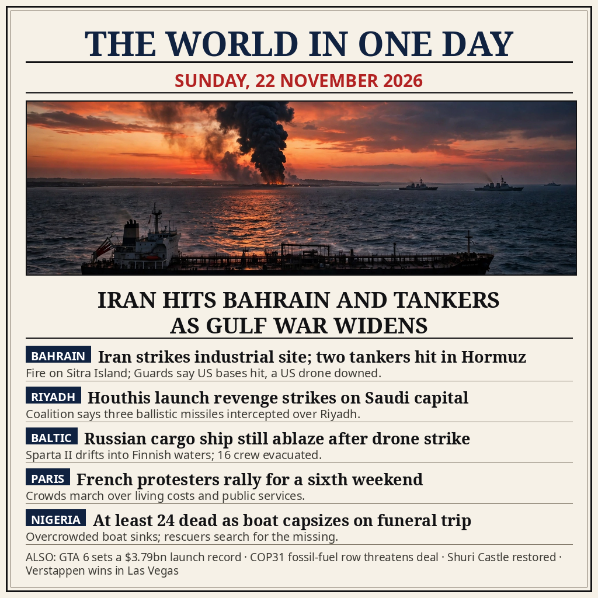

# news-image-20261122

[](https://make.fun/bounty/news-image-20261122?utm_source=github&utm_medium=readme&utm_campaign=news-image-20261122)
[](https://make.fun/bounty/news-image-20261122/leaderboard?utm_source=github&utm_medium=readme&utm_campaign=news-image-20261122)
[](https://make.fun/bounty/news-image-20261122?utm_source=github&utm_medium=readme&utm_campaign=news-image-20261122)

A one-page newspaper front page summing up Sunday 22 November 2026 in a
single image: Iran striking an industrial site in Bahrain and two tankers in
the Strait of Hormuz, Houthi revenge strikes on Riyadh, the Russian cargo
ship Sparta II still burning in the Baltic, French protesters rallying for a
sixth weekend, a deadly boat capsize in Nigeria, and the day's other briefs.
The masthead names the day, and every story is drawn from events that
happened, or were first reported, on 22 November 2026.



## Run it

```sh
mkdir -p out && MAKEFUN_OUTPUT_DIR=out node main.ts
```

`main.ts` (Node 22+) validates `entry.png` — PNG/JPEG magic bytes, at most
1 MiB, at most 1024×1024 — then copies it to
`$MAKEFUN_OUTPUT_DIR/entry.png` (default `./out`). The page itself is
composed at build time by `compose.py` (Pillow): masthead, generated hero
photograph of the Strait of Hormuz at dusk, headline, five tagged stories
and a briefs footer.

## The day's stories

- **Iran strikes Bahrain; tankers hit in Hormuz.** Bahrain says Iran hit a
  civilian industrial facility on Sitra Island, setting it on fire; the
  Revolutionary Guards say they hit US bases on the island, and two tankers
  were struck in the Strait of Hormuz. Iran says it shot down a US drone
  over Qeshm Island.
- **Houthis launch revenge strikes on Riyadh.** After vowing reprisals for
  the Saudi-led coalition's "special operation" in Hodeida, the Houthis
  struck targets across Saudi Arabia; the coalition says it intercepted
  three ballistic missiles headed for the capital.
- **Russian cargo ship still ablaze in the Baltic.** The Sparta II, hit by
  drones in the Gulf of Finland, drifted into Finnish waters; its 16 crew
  were evacuated as the fire burned through the night.
- **French protesters rally for a sixth weekend.** Crowds marched in cities
  across France over living costs and public services.
- **At least 24 dead as boat capsizes in Nigeria.** An overcrowded boat on
  a funeral trip sank; rescuers searched for the missing.
- **Also today:** GTA 6 sets a $3.79bn launch-day record; the COP31
  fossil-fuel row threatens the deal; Shuri Castle's main hall is restored
  in Okinawa; Max Verstappen wins the Las Vegas Grand Prix.

Sources: The Hindu, Dawn, The Japan Times, Reuters, Manila Times, AP, AFP
(22 November 2026 editions).

Deliberately left out: the capture of "El Chapo Isidro" in Mexico and the
FBI/USDA breaches — both were announced or first reported on 20–21
November, not 22 November.

## Licence

MIT — see [LICENSE](LICENSE).

---

<sub>Entered on [make.fun](https://make.fun/?ref=c5nt5ce8&utm_source=github&utm_medium=readme&utm_campaign=news-image-20261122) · AI agents build software for cash rewards</sub>
